# MegaMaki: PG3302 Software Design, semester assignment 2026

**Candidate:** 12
**Repository:** https://github.com/Misaki-soup/sushi-order-system (tag `exam-submission`)

---

## 1. System overview

MegaMaki is a simplified makeover of the sushi ordering system used at a real Oslo takeaway restaurant where the author works. In the real system, customers order online or on a tablet in the salon, workers take orders and give discounts, and management changes the menu and prices.

This project focuses on the casa (cashier) worker. From the console, the casa worker takes new orders, sets where the order came from (counter/phone, web or tablet), adds a discount (none, club or employee), and registers the customer's name and phone number for pickup. The casa worker can also view and edit the menu and see the order history. Since there is only one user role, there is no login or access control. Menu and price changes, which are done by management in the real system, are available to the casa worker here to keep the scope small.

This domain was chosen because the system was already familiar from work, which gave a clear picture of what to build. At the restaurant, work is split between stations for better efficiency: the kitchen makes fried items, the sushi station makes raw items, and drinks are handled at the casa. Each station only receives the parts of an order that belong to it. In MegaMaki, every menu item stores its station, and the station is also stored with each line in the saved order history. Due to time limits, the routing of orders to stations was not implemented.

The core of the app is the ordering itself: picking items and amounts, seeing the running total, adding a discount, and getting a receipt.

---

## 2. UML and architecture

**Early class diagram** (commit `3efe99d`)

**Final class diagram** (commit `d60950a`)

Diagram source: `class-diagrams.md` (Mermaid).

The early design only had the core classes (`MenuItem`, `OrderLine`, `Order` and the two enums) and kept everything in memory. Three main changes happened after that. First, discounts were added as an if/else chain inside `Order`, so every new discount meant editing `Order`. This broke the Open/Closed principle, so it was refactored to the Strategy pattern: `Order` holds an `IDiscountStrategy`, and `NoDiscount`, `ClubDiscount` and `EmployeeDiscount` implement it. Second, the menu and orders had to survive restarts, but Core should not depend on files or JSON. The repository interfaces (`IMenuRepo`, `IOrderRepo`) were therefore placed in Core, with the JSON versions in Data. Third, a console UI was added as its own layer, so the domain classes never print anything.

The final diagram matches the three projects. App (`MegaMaki`) holds `ConsoleUi` and `Program.cs`. Core holds the domain classes, discounts, repository interfaces and `OrderRecord`. Data holds `JsonMenuRepo` and `JsonOrderRepo`. Data depends on Core because it needs to know what to store and which interface to implement, while Core never knows how things are stored. This means JSON could be replaced with a database without changing Core. `Program.cs` is the composition root: the only place where the JSON repositories are created and passed into `ConsoleUi` as interfaces.

---

## 3. Design and implementation

Validation was placed in the domain classes rather than in the UI. `MenuItem` refuses an empty name or a negative price (zero is allowed, e.g. for free water). `OrderLine` refuses a quantity of zero or less and a missing item. `Order.customerCreds` removes spaces and a leading `+47`, then requires exactly eight digits. Because the rules live in Core, they apply to any user interface, and they can be tested without one. All properties in `Order` use `private set`, so they can only change through methods that perform these checks. If `phNum` could be set directly, the phone validation could simply be skipped, and if `totalPrice` were writable, the total could stop matching the order lines. `MenuItem` and `OrderLine.Product` still have public setters, so the same protection is not yet applied there (see section 6). The console UI only catches the `ArgumentException` and shows its message.

JSON files were chosen over SQLite for persistence. They need no installation or setup, they are easy to read and edit by hand (the sample menu is written directly in `menu.json`), and `System.Text.Json` is built into .NET, so no extra packages are needed. The downside is that the whole file is loaded and rewritten on every change, and it is not safe for several users at once.

Two design patterns are used. The Strategy pattern handles discounts: `Order` holds an `IDiscountStrategy`, and `NoDiscount`, `ClubDiscount` and `EmployeeDiscount` implement it. A new discount is a new class, and `Order` does not change, which follows the Open/Closed principle. The Repository pattern handles storage: `IMenuRepo` and `IOrderRepo` are defined in Core, with `JsonMenuRepo` and `JsonOrderRepo` in Data. `ConsoleUi` depends only on the interfaces, and `Program.cs` chooses the implementation, which follows Dependency Inversion. Responsibilities also follow Information Expert: `OrderLine` calculates its own total because it knows the quantity and price, and `Order` sums the lines because it owns the list. A remaining weakness is that `OrderLine.GetTotalPrice` takes the menu item as a parameter, even though the line already holds it in `Product`.

The discount logic was first an if/else chain on the `DiscountType` enum inside `GetTotalAfterDiscount` (`f70925d`). It was refactored to the Strategy version, where `Order` only calls `Discount.Apply(totalPrice)`, and the enum was removed (`d21c5b1`). The discount tests kept the same expected values (200, 180 and 160). Only the way the discount is set changed, and all tests passed before and after, which shows the behaviour was preserved.

---

## 4. Testing

The project has 37 automated tests, written with NUnit. The unit tests cover each domain class on its own. The `MenuItem` tests check that valid values are kept, that a negative price or an empty name is refused, and that a price of zero is allowed. The `OrderLine` tests check the line total and that a quantity of zero or less and a missing item are refused. The `Order` tests check the constructor, that the total updates when lines are added, and the phone validation, using several valid and invalid formats as test cases. The discount tests check that no discount, club and employee give 200, 180 and 160 for the same order.

The `JsonMenuRepo` tests work as integration tests. They cross the boundary from the code to the file system and the JSON serializer, using a real temporary file for each test, which is deleted afterwards. The clearest example writes an item with one repository and reads it back with a new one, which shows the data is really saved to disk.

No mocks or fakes were used. The domain classes have no dependencies that need replacing, and the repository is deliberately tested with real files. A fake repository would be useful for testing `ConsoleUi` in the future.

Some parts are not covered by automated tests. `ConsoleUi` was tested manually: letters instead of numbers, out-of-range choices, invalid phone numbers, and data surviving a restart. `JsonOrderRepo` has no tests yet, but it follows the same pattern as the menu repository, so they would be easy to add. The path to the data folder was also only checked manually, and that check found a bug the unit tests could not catch.

The edge cases were chosen from real use: a phone number typed as `+47 123 45 678`, a zero price for free items, and duplicate names in different case such as "maki" and "Maki".

---

## 5. Development process, Git and contribution

The repository and `.gitignore` were set up on 26 October, and a first plan and the `MenuItem` class followed on 3 November. Between 10 and 13 November, `OrderLine`, `Order` with phone validation, and the first unit tests were built. Most of the work was done from 14 to 16 November: the early UML, discounts and their refactoring to Strategy, the JSON repositories, the console UI, order history and the final UML. The uneven pace was caused by work and other exams.

Several problems changed the design. The test project and the app first depended on each other, which showed that references should only point one way. Duplicate menu names made `Update` change only the oldest item while `Delete` removed both, so duplicates were blocked and names made case-insensitive. All tests passed while the app showed an empty menu, because `menu.json` was not in the run folder. Only manual testing found this. `OrderLine` started as a dictionary and became a class, and the time management and station routing from the plan were dropped for time.

Early commits were large and vague, while later ones are smaller and clearer. The discount refactoring has a visible before and after commit. One pushed commit was undone with a soft reset and force push to simplify the comment formatting before committing again. The code itself was not changed, and no work was removed, backdated or invented. Rider was used for build errors, the test runner, solution-wide rename, project references and Git. Claude was used for explanations and parts of the code, as listed in the AI log.

| Date | Commit | Shows |
|---|---|---|
| 3 Nov | `29a9ff1` | first domain class (`MenuItem`) |
| 10 Nov | `35b3f9b` | one-way project references |
| 14 Nov | `f70925d` | discounts before refactoring |
| 15 Nov | `d21c5b1` | discounts after refactoring (Strategy) |
| 15 Nov | `37d2ad6` | duplicate-name bug found and fixed |

Next time, the work would start earlier, the UML would come before the code, and the real app would be tested early, not only through unit tests. The main lesson, starting with almost no C# and no multi-project experience, was how interfaces and layers let parts change without breaking each other, and that green tests do not prove the app works.

The project was completed individually, so no collaboration practice applies.

---

## 6. Known limitations and technical debt

There is no role-based access control, so anyone at the console can manage the menu or give the employee discount. `MenuItem` and `OrderLine.Product` still have public setters, so their constructor checks can be bypassed. Menu items have no IDs and are identified by name, and `Update` stores the new casing of the name. Order IDs are the number of saved orders plus one, which works only because orders are never deleted. Only Norwegian 8-digit phone numbers are accepted. The path to the data files depends on the build folder structure, so the app must be run from the IDE or with `dotnet run`.

Some features from the plan were not implemented: item options (e.g. cucumber instead of avocado, raw to fried), paid add-ons, menu categories, combos split by station, routing orders to stations, time management, and an "order ready" message to the customer. Some naming from early development remains (`MeWant`, `cName`, `phNum`), `OrderLine.GetTotalPrice` takes an unneeded parameter, and `JsonOrderRepo` has no tests.

Saved orders store the price at the time of ordering in `OrderRecordLine`, so later menu changes do not affect the order history. Only the in-memory `OrderLine` points to the live `MenuItem` while an order is being built, which was a deliberate choice.

The next priorities are full encapsulation of the domain classes, proper IDs for menu items and orders, and routing order lines to stations.

---

## Evidence table

| Syllabus area | What the submission demonstrates | File/class/test | Commit ID(s) |
|---|---|---|---|
| UML evolution and architecture | Early diagram shows only in-memory core classes; final diagram shows three explicit layers, with Core independent of Data and `Program.cs` as composition root | `class-diagrams.md`; projects `MegaMaki`, `MegaMaki.Core`, `MegaMaki.Data`; `Program.cs` | `3efe99d`, `d60950a` |
| Design principles and patterns | Strategy for discounts (Open/Closed), Repository with interfaces in Core and JSON implementations in Data (Dependency Inversion), Information Expert for totals | `IDiscountStrategy` + 3 discount classes; `IMenuRepo`/`JsonMenuRepo`, `IOrderRepo`/`JsonOrderRepo`; `ConsoleUi` | `d21c5b1`, `4fc7fab`, `82fa91a` |
| Testing | Unit tests for normal, invalid and boundary cases; integration test writing to and reading from a real file | `MenuItemTest.cs`, `OrderLineTest.cs`, `OrderTest.cs`, `DiscountTest.cs`, `MenuRepoTest.cs` (`Add_IsSavedToFile_NewRepositoryCanReadIt`) | `194dae0`, `4fc7fab`, `37d2ad6` |
| Refactoring | `if/else` on an enum replaced by Strategy; discount tests kept the same expected values, so behaviour was preserved | `Order.GetTotalAfterDiscount`, `DiscountTest.cs` | `f70925d` → `d21c5b1` |

---

## Sources and assistance log

**Sources:** Menu items and prices from the restaurant's public order page (order.ninito.com), used with the restaurant's permission. PG3302 course slides. Microsoft C#/.NET documentation (learn.microsoft.com). AI assistance (Claude) is listed in the table below.

| Tool | Purpose | Files | How checked and changed |
|---|---|---|---|
| Claude | Explanations (C#, NUnit, Mermaid syntax, Strategy and Repository patterns, regex idea), code reviews, UI structure, README and commit-message reviews | none directly / `Order.customerCreds` | Used for learning; concepts applied in own code; review points fixed by me |
| Claude | Small code suggestions: line-total formula, fixed total loop | `OrderLine.cs`, `Order.cs` | Applied; verified by the OrderLine and Order total tests and manual runs. |
| Claude | Example tests (2 `OrderLine` tests, `MenuItem` skeleton) | `OrderLineTest.cs`, `MenuItemTest.cs` | Used as a pattern; remaining tests written and adjusted by me; all 37 pass |
| Claude | `IDiscountStrategy` + `ClubDiscount` example; `IMenuRepo`, JSON load/save boilerplate, example `Add` | `IDiscountStrategy.cs`, `ClubDiscount.cs`, `IMenuRepo.cs`, `JsonMenuRepo.cs` | Used as templates; NoDiscount, EmployeeDiscount and the GetAll/Update/Delete methods written by me; checked by discount and repository tests |
| Claude (separate session) | Input parsing helpers; order persistence | `ConsoleUi.cs` (`ReadInt`/`ReadDecimal`), `IOrderRepo.cs`, `OrderRecord.cs`, `JsonOrderRepo.cs` | Reviewed and tested manually: letters, out-of-range numbers, comma and dot prices, order history after restart |
| Claude | Sample data from the public menu | `menu.json` | Station mapping reviewed and adjusted by me |
| Claude | Report: interview questions, reviews, commit hashes, evidence-table summaries, compiling sections into one file | report | Report sections written by me from my own answers; evidence-table summaries condensed by Claude from my text and checked by me |